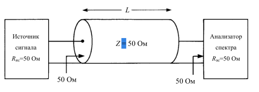
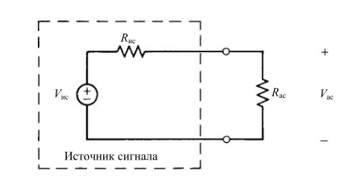

## Анкета

Перед началом практики пройдите, пожалуйста, короткий опрос: зачем вы пришли на курс и что вам в нём интересно.

[Ссылка на анкету](https://forms.yandex.ru/u/6aec4b6695add51a22b5b679)

### 1. Расшифровка обозначений и формул
*   **дБ/мкВ** (dBµV) - опорное напряжение **1 микровольт (1 мкВ = 10⁻⁶ В)**.
    *   `U(дБ/мкВ) = 20 * lg( U(В) / 1 мкВ )`
    *   `U(В) = 10^(U(дБ/мкВ) / 20) * 1 мкВ`
*   **дБ/мВт** (dBm) - опорная мощность **1 милливатт (1 мВт = 10⁻³ Вт)**.
    *   `P(дБм) = 10 * lg( P(Вт) / 1 мВт )`
    *   `P(Вт) = 10^(P(дБм) / 10) * 1 мВт`
*   **дБ/мА** (dBmA) - опорный ток **1 миллиампер (1 мА = 10⁻³ А)**.
    *   `I(дБ/мА) = 20 * lg( I(А) / 1 мА )`
    *   `I(А) = 10^(I(дБ/мА) / 20) * 1 мА`
*   **дБмВ** (dBmV) - опорное напряжение **1 милливольт (1 мВ = 10⁻³ В)**.
    *   `U(дБмВ) = 20 * lg( U(В) / 1 мВ )`
    *   `U(В) = 10^(U(дБмВ) / 20) * 1 мВ`
*   **дБмкВ** (dBµV) - то же самое, что и **дБ/мкВ**.
*   **дБм** (dBm) - то же самое, что и **дБ/мВт** (мощность!)
*   **дБмкВ/м** (dBµV/m) - опорная напряжённость поля **1 микровольт на метр (1 мкВ/м)**.
    *   `E(дБмкВ/м) = 20 * lg( E(В/м) / 1 мкВ/м )`
    *   `E(В/м) = 10^(E(дБмкВ/м) / 20) * 1 мкВ/м`

Перевести из децибел в абсолютную величину и наоборот
следующие значения. При переходе между мощностью и напряжением принять сопротивление нагрузки R = 50 Ом:

| 24 дБ/мкВ→В      | 21 мВ→дБ/мкВ       |
| ---------------- | ------------------ |
| 43 дБ/мВт→Вт     | 61,3 мкВт→дБ/мВт   |
| -13 дБ/мА→А      | 2,2 А→дБ/мА        |
| -26 дБмВ→мкВ     | 670 мкВ→дБм        |
| -35 дБм→мВ       | 21 мВ→дБм          |
| -16 дБм→мВ       | 30 В→дБм           |
| 36 дБмВ→мкВ      | 0,5 мкВ→дБмкВ      |
| -228 дБмВ→мкВ    | 200 В/м→дБмкВ / м  |
| 1 мВ / м→дБмкВ/м | 100 мВ/м→дБмкВ / м |

# Задача 2

Условие: источник сигнала с выходным сопротивлением 50 Ом подключается
к анализатору спектра с внутренним сопротивлением 50 Ом с помощью
коаксиального кабеля RG58U c волновым сопротивлением Z = 50 Ом длиной
30 футов (погонное затухание кабеля α = 4,5 дБ на 100 футов длины). Если
уровень сигнала на выходе источника сигнала на частоте 100 МГц
составляет -30 дБм, определите напряжение на входе анализатора спектра на
данной частоте в [мВ] и [дБмкВ].

1. Описанную в условиях задачи установку можно представить в следующем
виде:

Условие задачи:
Источник сигнала (Rис = 50 Ом, Pис = -30 дБм на 100 МГц)
→ Кабель (Z = 50 Ом, длина L, затухание α)
→ Анализатор спектра (Rас = 50 Ом)

Требуется найти Vас [мВ] и Vас [дБмкВ]

Пример решения (для L = 30 футов, α = 4.5 дБ/100 футов):

1. Затухание в кабеле:
A = α × (L/100) = 4.5 × (30/100) = 1.35 дБ

2. Мощность на анализаторе:
Pас [дБм] = Pис [дБм] - A = -30 - 1.35 = -31.35 дБм

3. Мощность в ваттах:
Pас [Вт] = 10^(-3) × 10^(Pас[дБм]/10) = 10^(-3) × 10^(-3.135) = 7.328 × 10^(-7) Вт

4. Напряжение:
Vас = √(Rас × Pас) = √(50 × 7.328 × 10^(-7)) = 6.053 × 10^(-3) В = 6.053 мВ

5. Напряжение в дБмкВ:
Vас [дБмкВ] = 20 × lg(Vас [В]/1 мкВ) = 20 × lg(0.006053/10^(-6)) = 75.635 дБмкВ

Задание 2.1:
Кабель: RG58U, Z = 50 Ом, L = 50 м, α = 4.5 дБ/100 футов
Рассчитать: Vас [мВ] и Vас [дБмкВ]

Задание 2.2:
Кабель: коаксиальный, Z = 50 Ом, L = 25 м, α = 5.7 дБ/100 футов
Рассчитать: Vас [мВ] и Vас [дБмкВ]

Примечание: 1 фут = 30.48 см
Остальные условия неизменны.